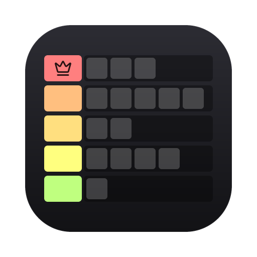

<p align="center">
  
</p>

<h1 align="center">Tier List Maker</h1>

<p align="center">
  Make tier lists with your own tiers, colors and images.<br>
  A native desktop app written in Rust. Made by <b>MacFlunder</b>.
</p>

## Download

Get the latest version from the **[Releases page](https://github.com/TrabiFR/tier-list-maker/releases/latest)**:

| Platform | File |
| --- | --- |
| **Windows 10/11** (installer) | `TierListMaker-x.y.z-windows-setup.exe`: adds a Start menu entry, an optional desktop shortcut and an uninstaller. No admin rights needed. |
| Windows 10/11 (portable) | `TierListMaker-x.y.z-windows-x64.exe`: a single file, no install needed. |
| **macOS 11+** (Apple Silicon & Intel) | `TierListMaker-x.y.z-macOS.dmg`: open it and drag the app into Applications. |

The app isn't signed with a paid certificate. On Windows, SmartScreen may show **More info → Run anyway**. On macOS, the first time you open it **right-click the app → Open**.

## Features

- **Tiers your way.** Add, delete, reorder and recolor tiers. Labels can be a letter, a word or a whole sentence. Pick a color from the palette or set a custom one, and choose automatic or custom text color.
- **Templates and presets.** Start from Classic (S–D), Extended (S–F), Numbers, Words or Blank, or **save your own tiers as a preset** (bookmark button in the editor) and reuse them for new lists.
- **Your images.** Click *Add images*, or drop files or whole folders onto the window. Supports PNG, JPG, GIF, WebP, BMP and TIFF. On macOS HEIC/AVIF (iPhone photos) work too. Phone photos are rotated correctly.
- **Drag & drop.** Drag images between tiers and the Unranked area. Right-click an image to rename it, move it or delete it.
- **Autosave.** Every change is saved on your computer within a second, so you can close the app and finish later.
- **Undo / redo.** Ctrl+Z / Ctrl+Y (⌘Z / ⌘⇧Z on Mac).
- **Customize.** Change image size, spacing, square or original shape, image names, label width and text size, and row and line colors.
- **Manage lists.** Rename, duplicate or delete tier lists from the home screen.
- **Export.**
  - **PNG image:** looks like the editor, at 1×/2×/3× quality, with an optional title.
  - **`.tierlist` file:** a full backup including the images. Use *Import* (or drop the file on the window) to open it on any computer.

## Where your tier lists are stored

- Windows: `%APPDATA%\Tier List Maker\`
- macOS: `~/Library/Application Support/Tier List Maker/`

Each list has its own folder with `list.json`, the original `images/` and fast-loading `thumbs/`. Presets are stored in `presets.json`. Uninstalling the app keeps this folder. Set the `TIERLIST_DATA_DIR` environment variable to use a different folder.

## Building from source

Install [Rust](https://rustup.rs), then:

```bash
cargo run --release   # run the app
cargo test            # run the tests
```

Release packages (built on a Mac):

```bash
./scripts/build-macos.sh     # dist/*.dmg (universal app)
./scripts/build-windows.sh   # dist/*-windows-setup.exe + portable .exe (needs: brew install mingw-w64 makensis)
```

On Windows you can build the app with `cargo build --release`, and the installer with `makensis /DVERSION=1.0.0 /DEXE=target\release\tierlist-maker.exe /DROOT=. installer\windows.nsi`.

| Path | What it contains |
| --- | --- |
| `src/` | The app: `editor.rs` (tier rows, drag and drop), `home.rs` (list overview), `dialogs.rs`, `export.rs` (PNG renderer), `storage.rs` (autosave, `.tierlist` files), `jobs.rs` (background image loading) |
| `assets/` | App icon (`app-icon.svg` is the source) and the Lucide icons |
| `installer/windows.nsi` | Windows installer script (NSIS) |
| `examples/make_icon.rs` | Renders the app icon, `.ico` and installer artwork from the SVG |

## Credits

Made by **MacFlunder**.

Built with [egui](https://github.com/emilk/egui). Icons from [Lucide](https://lucide.dev) (ISC license, see `assets/icons/LICENSE`).
